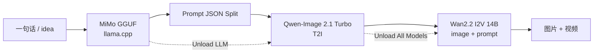
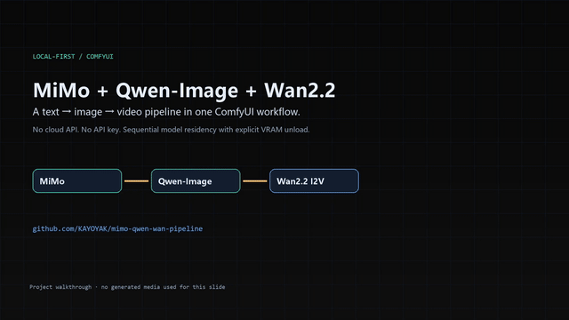
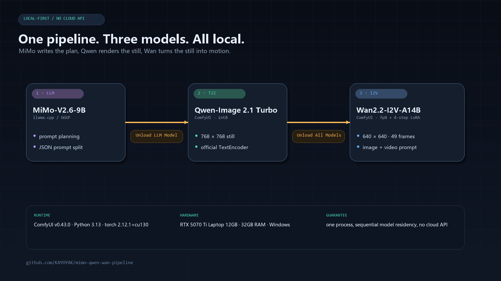
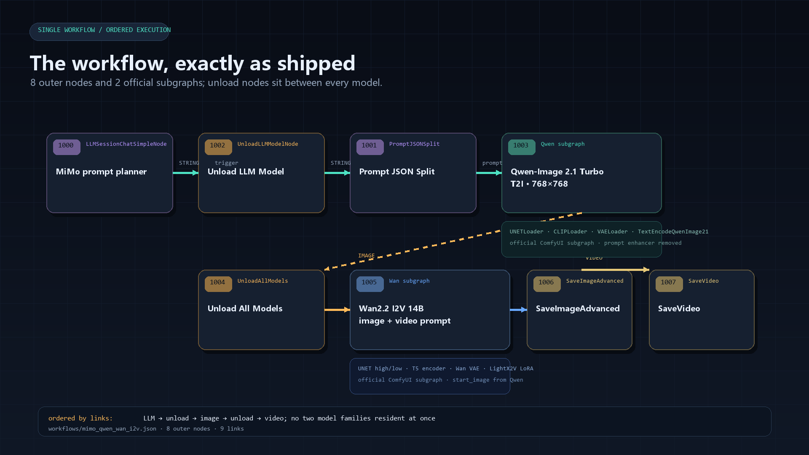
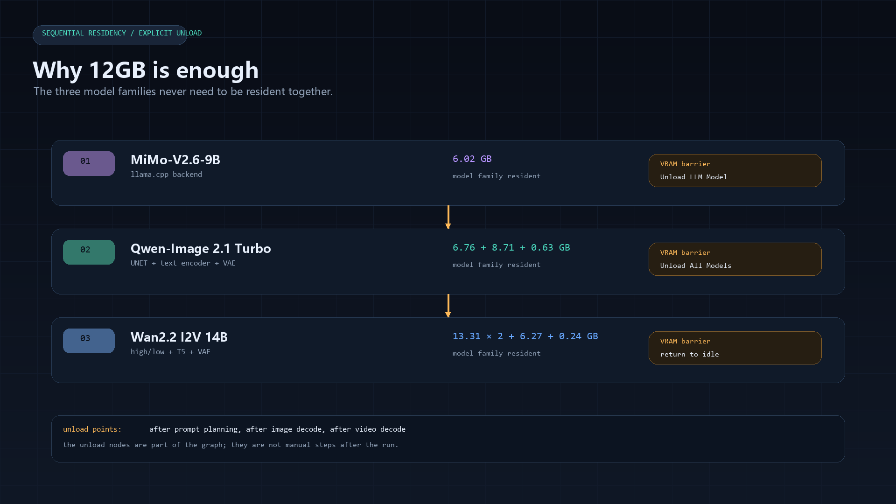
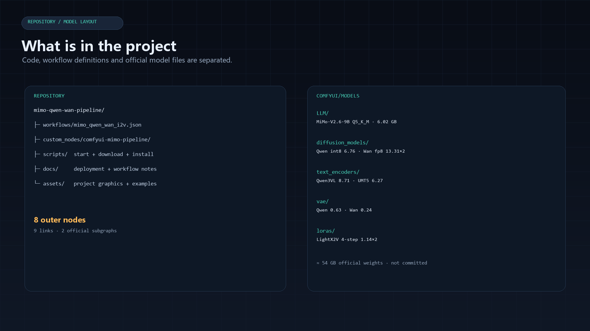
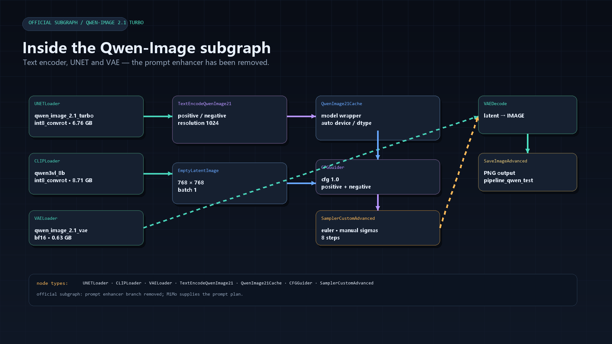
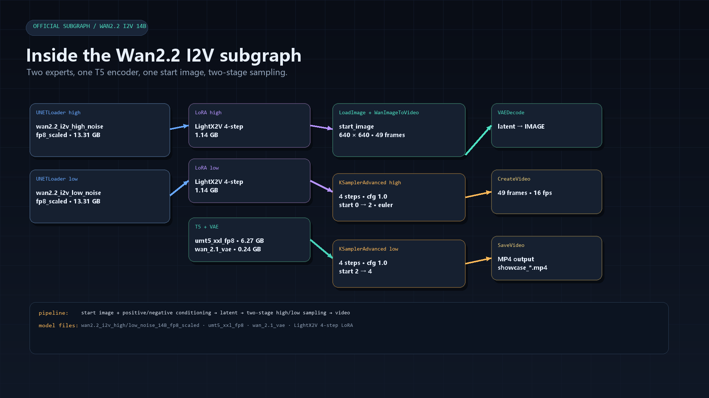
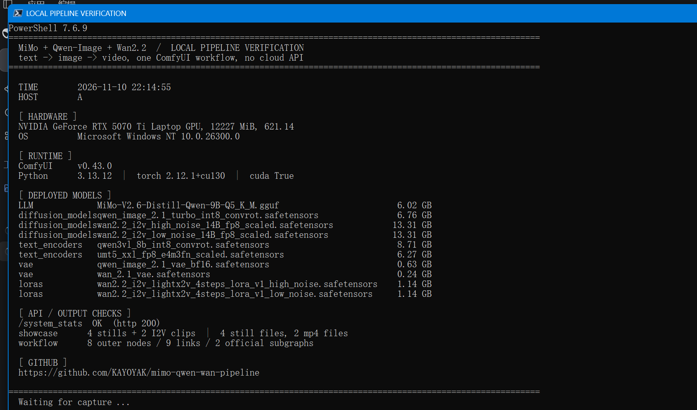
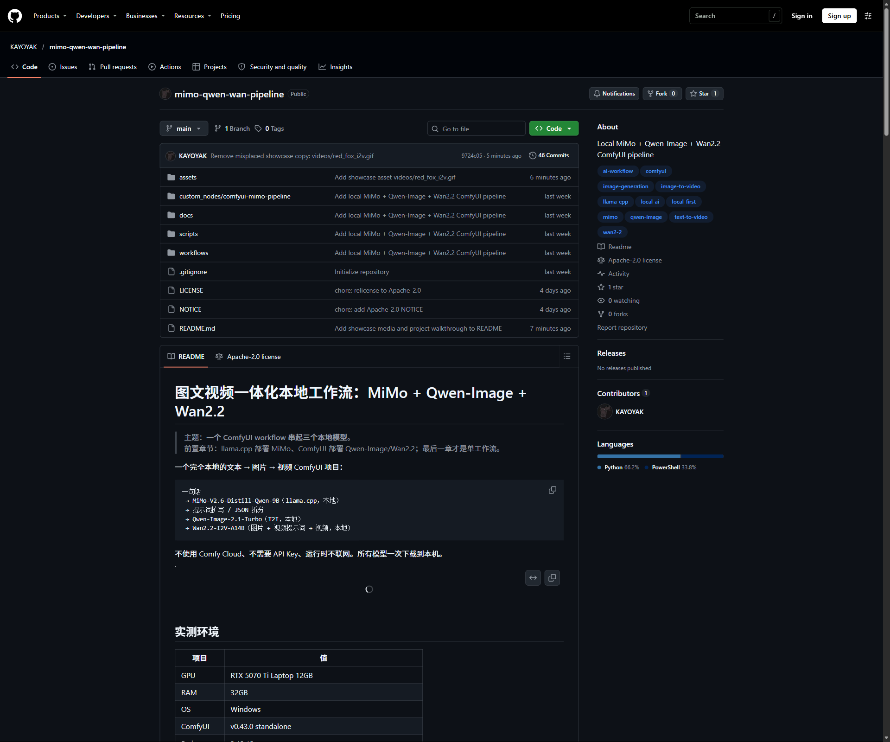

# 图文视频一体化本地工作流：MiMo + Qwen-Image + Wan2.2

> 主题：**一个 ComfyUI workflow 串起三个本地模型**。  
> 前置章节：llama.cpp 部署 MiMo、ComfyUI 部署 Qwen-Image/Wan2.2；最后一章才是单工作流。

一个完全本地的文本 → 图片 → 视频 ComfyUI 项目：

```text
一句话
 → MiMo-V2.6-Distill-Qwen-9B（llama.cpp，本地）
 → 提示词扩写 / JSON 拆分
 → Qwen-Image-2.1-Turbo（T2I，本地）
 → Wan2.2-I2V-A14B（图片 + 视频提示词 → 视频，本地）
```

不使用 Comfy Cloud、不需要 API Key、运行时不联网。所有模型一次下载到本机。



## 实测环境

| 项目 | 值 |
|---|---|
| GPU | RTX 5070 Ti Laptop 12GB |
| RAM | 32GB |
| OS | Windows |
| ComfyUI | v0.43.0 standalone |
| Python | 3.13.12 |
| PyTorch | 2.12.1+cu130 |
| 模型总大小 | 约 54GB（Qwen 约 16GB + Wan 约 36GB + MiMo 6GB） |

本项目在 Windows 上用 ComfyUI standalone 环境实测；ComfyUI Desktop 也可以，
只要版本不低于 v0.43、模型目录指对即可。

## 项目展示

### 65 秒项目演示

[](assets/project/tour.mp4)

- [▶ 项目演示视频 MP4](assets/project/tour.mp4)
- 路径：架构 → workflow → 显存时序 → Qwen/Wan 子图 → 真实终端 → 部署验证 → 仓库结构 → GitHub 页面 → 示例输出

### 架构与发布的 workflow

| 架构 | 已发布 workflow |
|---|---|
|  |  |

### 显存顺序与项目结构

| 顺序执行 / 显存卸载 | 仓库与模型目录 |
|---|---|
|  |  |

### Qwen / Wan 官方子图内部

| Qwen-Image 2.1 子图 | Wan2.2 I2V 子图 |
|---|---|
|  |  |

### 真实运行验证

| 本地终端 | GitHub 仓库页面 |
|---|---|
|  |  |

| 部署指标 | 值 |
|---|---|
| ComfyUI / Python / PyTorch | v0.43.0 / 3.13.12 / 2.12.1+cu130 |
| GPU | RTX 5070 Ti Laptop 12GB |
| 官方权重 | 约 54GB |
| Qwen-Image 768×768 | 27.2 / 34.9 / 38.2 / 56.0 秒 |
| Wan2.2 I2V 49 帧 | 102.5 / 89.2 秒 |
| 工作流 | 8 个外层节点 · 9 条连线 · 2 个官方子图 |

### 示例输出（SFW）

|  |  |
|---|---|
|  |  |
|  |  |

| 图生视频 | GIF 预览 |
|---|---|
| [雪中小屋 I2V MP4](assets/videos/snow_cabin_i2v.mp4) |  |
| [红狐 I2V MP4](assets/videos/red_fox_i2v.mp4) |  |

> 工程图、终端截图、GitHub 页面和 workflow 图展示项目本身；4 张图和 2 条视频是管线的 SFW 示例输出。
## 文档导航

1. [本地部署 MiMo-V2.6-9B（llama.cpp）](docs/DEPLOY_MIMO.md) — 独立 llama-server 与 ComfyUI 内 LLM 节点两条路径
2. [本地部署 Qwen-Image-2.1-Turbo 与 Wan2.2-I2V-A14B](docs/DEPLOY_QWEN_WAN.md) — 文件清单、放置目录、官方模板验证
3. [单工作流架构与显存顺序](docs/WORKFLOW.md) — 8 个外层节点、两次卸载、子图连接
4. [模型清单与许可](docs/MODELS.md)

## 项目结构

```text
README.md
workflows/
  mimo_qwen_wan_i2v.json       # 单文件 ComfyUI 工作流
custom_nodes/
  comfyui-mimo-pipeline/       # PromptJSONSplit 节点
scripts/
  start_llama_server.ps1       # 独立 llama.cpp 部署 MiMo
  download_models.ps1          # 下载 Qwen/Wan 官方权重
  install_custom_nodes.ps1     # 安装 ComfyUI 社区节点
  start_comfyui.ps1
  build_workflow.py
docs/
  MODELS.md
  WORKFLOW.md
```

---

# 1. 用 llama.cpp 本地部署 MiMo-V2.6-9B

## 1.1 准备 llama.cpp

使用带 CUDA 的 Windows 发行包，或自行编译。从
[llama.cpp releases](https://github.com/ggml-org/llama.cpp/releases) 下载
`llama-b*-bin-win-cuda-*.zip`，解压后目录示例：

```text
D:\llama.cpp\llama-b11270-bin-win-cuda-13.4-x64\llama-server.exe
```

需要版本支持 `qwen35` 架构；MiMo 是混合结构，太旧的 llama.cpp 会报 tensor 不存在。

## 1.2 准备 GGUF

目录示例：

```text
D:\models\MiMo-9B-GGUF\
├── MiMo-V2.6-Distill-Qwen-9B-Q5_K_M.gguf
└── mmproj-MiMo-V2.6-Distill-Qwen-9B-f16.gguf   (可选)
```

本工作流只做纯文本提示词，**不需要 mmproj**。

## 1.3 启动服务

CPU 模式（推荐给 12GB 显存机器，给 ComfyUI 留满显存）：

```powershell
powershell -ExecutionPolicy Bypass -File .\scripts\start_llama_server.ps1 `
  -GpuLayers 0
```

GPU 模式（仅用于单独测试；跑 ComfyUI 工作流前必须停掉）：

```powershell
powershell -ExecutionPolicy Bypass -File .\scripts\start_llama_server.ps1 `
  -GpuLayers 99
```

## 1.4 手动启动命令（脚本内部等价）

```powershell
& "D:\llama.cpp\llama-b11270-bin-win-cuda-13.4-x64\llama-server.exe" `
  -m "D:\models\MiMo-9B-GGUF\MiMo-V2.6-Distill-Qwen-9B-Q5_K_M.gguf" `
  --alias mimo-v2.6-distill-qwen-9b `
  --host 127.0.0.1 --port 8080 `
  --n-gpu-layers 0 --ctx-size 32768 --threads 8 `
  --jinja --reasoning-budget 0
```

## 1.5 验证

```powershell
Invoke-RestMethod http://127.0.0.1:8080/health

$body = @{
  model = "mimo-v2.6-distill-qwen-9b"
  messages = @(@{ role = "user"; content = "用一句话介绍你自己。" })
  max_tokens = 64
} | ConvertTo-Json -Depth 6

Invoke-RestMethod http://127.0.0.1:8080/v1/chat/completions `
  -Method Post -ContentType "application/json" `
  -Body ([Text.Encoding]::UTF8.GetBytes($body))
```

> 工作流里的 `LLM Session Chat` 节点是在 ComfyUI 进程内通过 llama.cpp backend
> 加载同一个 GGUF，因此默认不需要单独启动 8080 服务。上面的独立部署用于验证
> 模型、命令行调试和其他客户端；两种方式不要同时占显存。

---

# 2. 本地部署两个生成模型

## 2.1 Qwen-Image-2.1-Turbo（文生图）

官方仓库：[Comfy-Org/Qwen-Image-2.1](https://huggingface.co/Comfy-Org/Qwen-Image-2.1)

下载三个文件，放到 ComfyUI 模型目录：

```text
ComfyUI/models/
├── diffusion_models/
│   └── qwen_image_2.1_turbo_int8_convrot.safetensors
├── text_encoders/
│   └── qwen3vl_8b_int8_convrot.safetensors
└── vae/
    └── qwen_image_2.1_vae_bf16.safetensors
```

注意：`qwen3.5_9b_qwen_image_2.1_pe_t2i` 是额外的 prompt enhancer，本项目不用；
提示词扩写由 MiMo 完成。

## 2.2 Wan2.2（图生视频）

官方仓库：[Comfy-Org/Wan_2.2_ComfyUI_Repackaged](https://huggingface.co/Comfy-Org/Wan_2.2_ComfyUI_Repackaged)

本项目默认使用 **I2V**：

```text
ComfyUI/models/
├── diffusion_models/
│   ├── wan2.2_i2v_high_noise_14B_fp8_scaled.safetensors
│   └── wan2.2_i2v_low_noise_14B_fp8_scaled.safetensors
├── text_encoders/
│   └── umt5_xxl_fp8_e4m3fn_scaled.safetensors
├── vae/
│   └── wan_2.1_vae.safetensors
└── loras/
    ├── wan2.2_i2v_lightx2v_4steps_lora_v1_high_noise.safetensors
    └── wan2.2_i2v_lightx2v_4steps_lora_v1_low_noise.safetensors
```

> 为什么不是 T2V：T2V 只吃文本，无法把 Qwen 生成的图片作为首帧。要“图片+提示词→视频”，
> 必须用 I2V。两者同属 Wan2.2 A14B 系列。

一键下载：

```powershell
powershell -ExecutionPolicy Bypass -File .\scripts\download_models.ps1 `
  -ComfyRoot "D:\AI\ComfyUI\ComfyUI_windows_portable" `
  -MiMoGguf "D:\models\MiMo-9B-GGUF\MiMo-V2.6-Distill-Qwen-9B-Q5_K_M.gguf"
```

---

# 3. 安装 ComfyUI 与工作流所需节点

## 3.1 ComfyUI

使用 ComfyUI Windows portable，假设安装在：

```text
D:\AI\ComfyUI\ComfyUI_windows_portable
```

## 3.2 社区节点

工作流依赖：

| 节点 | 用途 |
|---|---|
| [ComfyUI-LLM-Session](https://github.com/kantan-kanto/ComfyUI-LLM-Session) | 在 ComfyUI 内通过 llama.cpp 跑 MiMo GGUF，提供 `LLM Session Chat` 和 `Unload LLM Model` |
| [ComfyUI-Unload-Model](https://github.com/SeanScripts/ComfyUI-Unload-Model) | 提供 `Unload All Models`，图片后释放显存 |

安装：

```powershell
powershell -ExecutionPolicy Bypass -File .\scripts\install_custom_nodes.ps1 `
  -ComfyRoot "D:\AI\ComfyUI\ComfyUI_windows_portable"
```

`ComfyUI-LLM-Session` 使用 `llama-cpp-python`。MiMo 的 `qwen35` 架构需要较新的
llama.cpp backend；请使用能识别 `qwen35` 的 JamePeng 预编译 wheel，或按
LLM-Session 的 COMPATIBILITY.md 选择构建。

## 3.3 放入 MiMo GGUF

如果把 MiMo 作为工作流内节点加载：

```text
ComfyUI/models/LLM/MiMo-V2.6-Distill-Qwen-9B-Q5_K_M.gguf
```

`download_models.ps1` 会用硬链接把本地 GGUF 放进这个目录。

---

# 4. 启动 ComfyUI 并加载单工作流

```powershell
powershell -ExecutionPolicy Bypass -File .\scripts\start_comfyui.ps1 `
  -ComfyRoot "D:\AI\ComfyUI\ComfyUI_windows_portable"
```

打开 `workflows/mimo_qwen_wan_i2v.json`。

工作流内部顺序：

```text
LLM Session Chat (MiMo)
 → Prompt JSON Split
 → Unload LLM Model
 → Qwen-Image 2.1 子图（出图）
 → Unload All Models
 → Wan2.2 I2V 子图（图片 + 视频提示词）
 → SaveImage / SaveVideo
```

首次运行前只需要改 `LLM Session Chat` 节点的 `user_text`。`model` 选择
`MiMo-V2.6-Distill-Qwen-9B-Q5_K_M.gguf`，`mmproj` 留空。

## 显存顺序

MiMo、Qwen-Image、Wan2.2 不会同时驻留：

1. MiMo 生成 JSON prompt；
2. `Unload LLM Model` 释放 LLM；
3. Qwen 出图；
4. `Unload All Models` 释放图片模型；
5. Wan I2V 出视频。

12GB 显存下如果 OOM，先降 Wan 的分辨率/帧数，再降 Qwen 分辨率。

---

# 5. 许可与使用边界

- 本仓库代码：Apache-2.0
- Qwen-Image 2.1 / Wan2.2 / MiMo：遵循各自模型许可
- 不要用生成内容侵犯肖像权、隐私或制作违法内容
